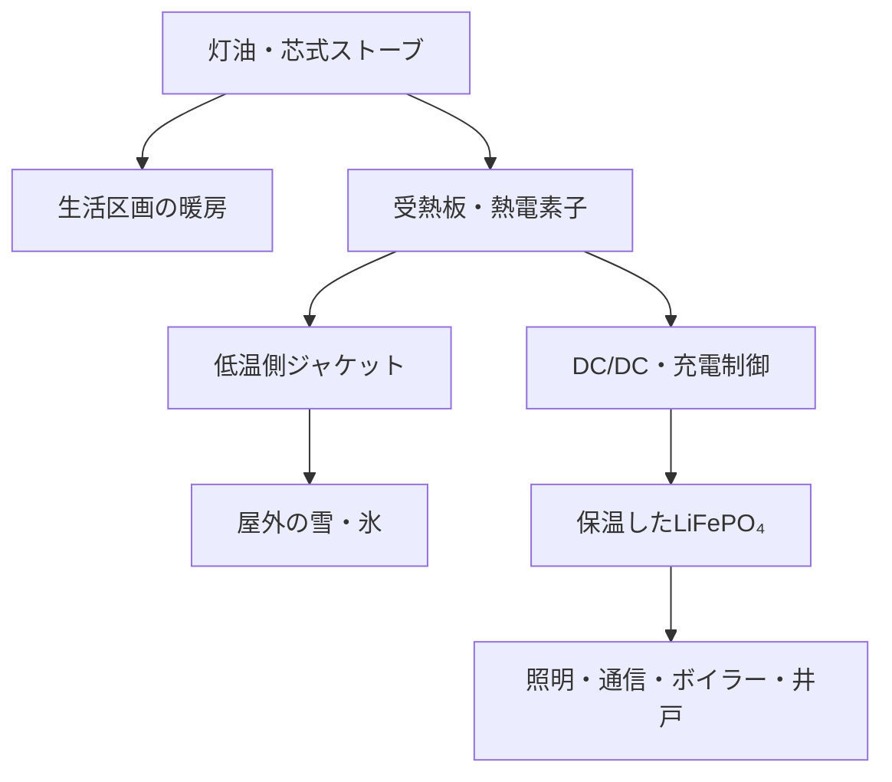

# ゴッドガンダム800ウイング：越冬縮小運転・コジェネシステム

**ディスクリプト: イーロン式ボイジャーカムイ発電**

ケロシンの熱と山形の雪を使い、越冬用の小区画とスニーカーグリッドを維持する構想。

記録日: 2026-11-05（JST）  
状態: 縮小運転への移行計画 / コジェネ設計・資源待ち / 発電試作・出力未測定  
出典: 同日のふさもふ本人による現場報告・設計意図・命名指定。室温・積雪・負荷の連続ログは本書には未収録。  
追跡: [越冬運用 #71](https://github.com/saitoomituru/ZeroRoomLab-manifest/issues/71) / [ゼーベック系 #72](https://github.com/saitoomituru/ZeroRoomLab-manifest/issues/72)

## 越冬のために維持する空間を縮める

投げ銭・研究維持資源の流入が得られない現状で、冬に向けて日常の稼働圏を寝室3畳へ集約する。18畳メインラボ（HPC・オシロ・3DP）、6畳加工場（レーザー）、4畳加工場（ボール盤・溶接機があった部屋）を主な生活・作業動線から閉鎖する計画である。移行完了は未記録。

本人の設計原則は「文明生存率はエネルギー密度。インカムが減るなら体積を下げて密度を上げる」。人間、電池、最低限の通信・作業機能を保温可能な小区画へ集め、同じ資源で越冬する。これは研究所維持費が届かないことによる物理的な縮退であり、恒久的な3畳化を研究所の完成形にはしない。

研究設備は[既存の現場報告](2026-10-15-offgrid-30days-field-report.ja.md)どおり全面停止中。文書・発信を続けられても、「思いつく→測る→作る→直す」の実機ループの復旧とは別である。閉鎖区画の設備・データを保全し、電力・部材・人手の到着で再開できる経路を残す。

## 熱・電力・冷熱を別の資源として使う

| 資源・条件 | 本人申告・現状 | 設計での役割 |
| --- | --- | --- |
| 芯式灯油ストーブ | 約2.4kW、燃焼に電源不要 | 暖房の一次熱源、コジェネ受熱源候補 |
| 灯油・ケロシン | 約10kWh/Lという燃料エネルギーの概算 | 熱エネルギーを持ち込む。発電量kWh/Lとは区別 |
| LiFePO₄ | 約980Whの公称蓄電容量 | スニーカーグリッドの電力バッファ |
| 電力負荷 | 照明・通信・風呂のボイラー・井戸汲み上げ等 | 負荷別Whと起動ピークを把握する |
| 寒冷 | 外気−17℃まで下がる | 生活区画・電池の保温と屋外冷熱の両方に関係 |
| 室温目標 | 20℃維持を本人が設定 | 電池を含む生活区画の温度管理目標 |
| 豪雪 | 積もるときは4〜6mという現場申告 | 発電低温側の雪・氷ヒートジャケット |
| 旧発電機 | 以前のディーゼルは金融ペインで差し押さえ | 現在の利用可能設備に数えない |

980Whの電池を暖房熱源として扱わない。20℃はこの構成での運用目標であり、全LiFePO₄共通の充放電下限ではない。型番・セル温度・BMSと充電器の条件は実機で合わせる。ボイラー・ポンプの熱源や方式、消費電力・起動電力は本対話だけで補完しない。

「日本10位の豪雪地帯」は本人による地域の説明として保存する。ランキングの集計条件は未特定であり、順位を設計計算の入力にしない。4〜6mは現在の実測積雪深を報告する数字ではない。現地の豊富な雪を、障害だけでなく利用可能な冷熱資源として扱う。

## 熱収支と電力収支

同じ形状なら長さは体積の1/3乗、表面積は2/3乗で変わる。既存家屋で区画を切る今回の暖房負荷は、外皮・間仕切りの断熱、隙間風、必要換気、室内外温度差、隣接区画との熱移動で決まる。畳数比だけで燃料削減率を確定しない。

定常時の概念収支は、ストーブから室内へ残す熱と発電部へ取り込む熱を分ける。発電部は `Q_hot = P_electric + Q_cold`。燃焼熱2.4kW全量が素子を通るわけではなく、`P_electric = η × Q_hot` の熱流・効率は実測対象である。

電池に届く正味電力は、発電端出力から変換損失・冷却ポンプやファン・制御消費を引いて求める。生活側は負荷別Wh/dayと起動ピークWを別々に記録する。小電力を蓄えて間欠的な汲み上げ等に回す構成では、平均発電Wだけで起動可否を判定できない。

| 仮の正味発電比較点 | 12時間での補給量 | 公称980Whに対する比率 |
| --- | ---: | ---: |
| 5W | 60Wh | 約6% |
| 10W | 120Wh | 約12% |
| 20W | 240Wh | 約24% |

上表は設計比較用の計算例。実現出力・稼働時間・実効電池容量を測定した結果ではない。補給負担がどれだけ減るかは、実際の負荷・暖房時間・損失と比較する。

## ゴッドガンダム800ウイングのゼーベック系

**プロダクト名は「ゴッドガンダム800ウイング」**、ゼーベック系の**ディスクリプトは「イーロン式ボイジャーカムイ発電」**とする。命名者はふさもふ。2026-11-05の本人指定。先行案「イーロン式ボイジャーカムイコジェネシステム」の着想を、プロダクト名と説明へ整理した。

### 命名と着想

- **イーロン式**: 本人の「ケロシン大好きイーロン」という連想。身近なケロシンを熱源にして構成する発想を名称へ残す。
- **ボイジャー**: 核電池の、熱から熱電素子で電気を取り出す発想を引く。NASAの解説でもVoyagerのRTGは熱電変換を用いる。本構想で使う熱源は灯油であり、放射性物質は使用しない。
- **カムイ**: 本人の「地球で山形ならカムイいる」という信仰・創作の接続。宇宙機の放射ラジエーターに代えて、地上で得られる雪をヒートジャケットにする。カムイという意味を削除せず、熱交換の工学記述と並存させる。

これは本人による命名と設計着想であり、イーロン・NASAとの公式な提携を表すものではない。カムイの信仰的意味を物理性能の測定値へ変換せず、物理説明を理由に名前を消さない。

### 系統案

雪に接続するのは発電部の低温側。電池は室内保温側に残す。雪ジャケットは、直接熱結合する交換器、または二次冷却ループで雪へ熱を送る方式等を比較し、現物・距離・部材から選ぶ。冷却ポンプを用いる場合は発電量からその消費を差し引く。

雪・氷の融解中は約0℃が基準になる。外気−17℃を、そのまま運転中の素子冷面温度としない。実際のΔTは両面の接合温度で測る。氷の融解熱を約334kJ/kgとして、100Wを融解だけで受ける概算なら約1.1kg/h。雪の体積は密度で変わり、接触面の融け離れ・空洞化・排水・再凍結・閉塞・補充労力が持続出力を決める。

雪の存在量が豊富であることを起点に、熱を運ぶ経路と温度差を維持する仕組みを設計する。室内に必要な暖房熱を残し、雪側へ流す熱と灯油消費も合わせて測る。

### 試作と反証・更新条件

1. 手持ち素子・均熱板・ヒートシンク・配管・充電器を棚卸しし、型番・耐熱・電気条件を確認する。冷却用ペルチェの転用は当該型番の条件で評価し、発電用TEGも比較する。
2. 天板の温度分布、受熱・低温側温度、熱界面と締結方法、燃焼への影響を把握する。
3. 取り外せる受熱部と雪ジャケットで負荷掃引し、V/I・温度・補機消費・電池へ届くWhを取る。
4. 融雪・再凍結、冷却停止、断線時の過熱保護・熱切離し、低温側の回復性を試す。暖房の燃焼・換気経路と着脱余地を維持する。
5. 正味電力が補機・変換損失に負ける、温度差が続かない、暖房を維持できない、燃料増分や補充作業が補給削減に見合わない場合は、その構成の失敗として保存し、受熱・冷却・負荷条件を更新する。

外部のストーブ熱電発電実験には冷却ファンと変換後に8.25Wを取り出した例があるが、今回の芯式灯油ストーブの実測値ではない。比較資料は実験成立の参照であり、今回の発電量を保証するものではない。

## スターリング発電の並行候補

スターリングエンジン＋発電機も保存する。高温側をストーブ、低温側を雪へ接続する候補で、熱交換器・気密・摩擦・発電機負荷込みの正味出力を評価する。材料、加工機利用、実機・エンジンの入手という資源イベントで起動できる。

ディスクリプトのゼーベック発電をスターリング発電と混同しない。一方の完成を他方の着手条件にせず、手持ち部材と加工協力から実行可能な枝を選ぶ。

## 越冬運用と復旧に必要な資源

| 枝 | 起動・継続に必要な資源 | 記録する結果 |
| --- | --- | --- |
| 3畳への集約 | 区画整理、断熱部材、燃料、設備保全の作業 | 実施状態、室温・電池温度、灯油L/day |
| スニーカーグリッド継続 | 充電先、運搬・輸送協力、配電・変換部材 | 負荷Wh/day、利用可能Wh、補給間隔と労力 |
| ゼーベック系 | 素子、受熱・冷却部材、DC/DC、対応充電制御、加工・計測 | 正味W/Wh、持続性、燃料収支、失敗・修理条件 |
| スターリング系 | エンジン・発電機、加工協力、熱交換・計測資源 | 負荷込み出力、起動・保守条件 |
| ラボ再開 | 研究用電力、部材・人手、計算・加工機の利用条件 | 再開できる設備と実験ループ |

本人が追加自弁する前提にしない。燃料、断熱、充電・輸送、素子や熱交換部材、加工機利用、計測、修理、維持費の非独占支援を求める。コジェネの未完成期間も生存・通信・水を維持する補給経路を保持する。豪雪による輸送中断の余裕は、実測負荷と補給可能日数から計算し、未知の値を埋めない。

支援は[非独占Seed Steward方針](../../FUNDING.md)に従う。縮小運転を完成した自立発電や研究復旧と表示せず、資源の到着によって区画・設備・実験能力を再び広げられるようにする。

## 参照

- [2026-10-15現場報告・10-19訂正](2026-10-15-offgrid-30days-field-report.ja.md)
- [Portable Civilization #47](https://github.com/saitoomituru/ZeroRoomLab-manifest/issues/47) / [Infra-FIRE #48](https://github.com/saitoomituru/ZeroRoomLab-manifest/issues/48)
- [研究電力・Blackhole等の資源募集 #52](https://github.com/saitoomituru/ZeroRoomLab-manifest/issues/52) / [資源還流 #58](https://github.com/saitoomituru/ZeroRoomLab-manifest/issues/58)
- NASA: [RTGとゼーベック効果](https://science.nasa.gov/resource/how-does-a-radioisotope-thermoelectric-generator-rtg-work-the-seebeck-effect/) / [Voyagerの機体・電源](https://science.nasa.gov/mission/voyager/spacecraft/)
- [Testing and Optimizing a Stove-Powered Thermoelectric Generator with Fan Cooling](https://www.mdpi.com/1996-1944/11/6/966)
